<div align="center">

# 💉WE GO FIT

### 치료비 부담을 나누는 특약, 보험사의 변화까지 함께 계산하다

**위고비 확산에 따른 약제비 특약 설계와 기존 보험금 영향 분석**

2026-2학기 DArt-B 제7회 학술제 · 보험 도메인 · 위험고비용

[발표자료 PDF](docs/presentation/WE_GO_FIT_final_presentation.pdf) · [고객용 MVP](https://we-go-fit-customer.fun-pike-8674.chatgpt.site/) · [보험사용 MVP](https://we-go-fit-insurer-drafts.fun-pike-8674.chatgpt.site/#one)

</div>

---

## 프로젝트 소개

위고비를 시작하는 사람이 늘어나면, 보험에는 어떤 변화가 생길까요?

치료비 지원은 고객의 부담을 덜어 주지만 보험사에는 새로운 지급을 만듭니다. 동시에 치료에 따른 건강위험 변화는 기존 사망·심혈관·수술 보험금에도 영향을 줄 수 있습니다. WE GO FIT은 이 두 흐름을 하나의 치료경로와 현금흐름 모형으로 연결했습니다.

**문헌 분석에서 출발해 보험료 산출, 수익성 검증, 기초서류 작성, 고객·보험사용 시뮬레이터까지 구현한 팀 프로젝트입니다.**

> 연구용 가상 상품과 조건부 시나리오 분석입니다. 제시한 보험료는 실제 판매 견적이 아니며, NPV는 회계이익이나 IFRS17 보험계약마진을 의미하지 않습니다.

## 1. 왜 이 연구를 시작했나요?

비만치료제에 대한 관심과 이용이 커지는 가운데, 반복적으로 발생하는 약제비는 치료를 이어 가는 데 부담이 됩니다. 보험사는 치료비를 지원할 때의 비용과 기존 보험금의 변화를 함께 살펴봐야 합니다.

| 연구 질문 | 분석 내용 |
| --- | --- |
| 치료가 확산되면 기존 보험금은 어떻게 달라질까? | 사망·심근경색·뇌졸중·담낭수술 담보별 변화 |
| 어느 수준의 약제비 보장이 가능한가? | 보장조건별 월보험료와 특약 손익 |
| 특약이 추가로 유도한 치료까지 고려하면? | 특약 NPV와 기존 보험금 조정액의 결합 |

## 2. 자료를 보험 의사결정으로 연결하기

임상 문헌, 치료 지속·중단·재개 자료, 국내 인구통계와 보험 관련 공개자료를 모아 분석 목적별 집단을 설정했습니다. 이후 일 단위로 치료와 계약 상태를 추적하고, 같은 경로에서 보험금과 보험료를 계산했습니다.

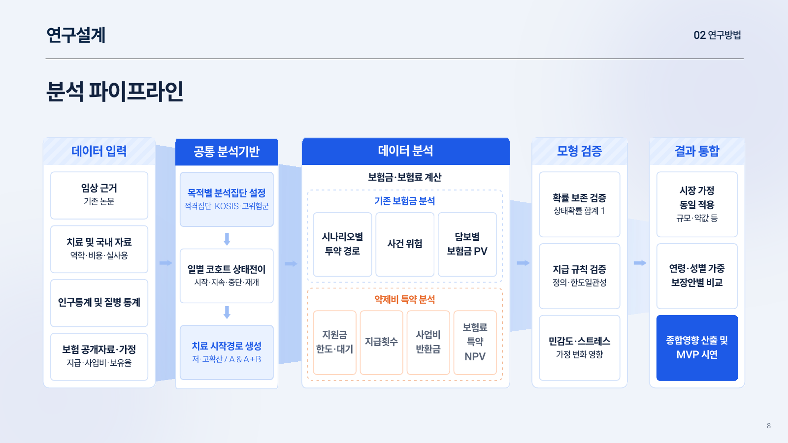

| 분석 요소 | 모형에서의 역할 |
| --- | --- |
| 최초 치료 시작 | 특약 없이 시작하는 A와 지원으로 추가되는 B를 구분 |
| 지속·중단·재개 | 실제 치료 노출과 28일분 조제 횟수 계산 |
| 계약 규칙 | 대기기간·지급한도·만기·사망·미경과보험료 반환 반영 |
| 임상 위험비 | 적용 대상과 효과기간을 제한해 기존 담보 보험금 계산 |
| 검증 | 확률·인원 보존, 지급 규칙, 극단 가정, 민감도와 스트레스 확인 |

가격산출은 치료 적격·비당뇨·가입 전 미사용자를 대상으로 합니다. 기존 보험금 효과에는 SELECT 유사 고위험군을 사용하며, 종합영향은 19~74세의 연령·성별 구성을 가중해 계산합니다. **49세 여성 10년형 예시와 전체 포트폴리오 결과는 구분합니다.**

## 3. 치료 확산은 기존 보험금을 얼마나 바꿀까요?

저확산과 고확산 시나리오를 비교한 결과, 분석 대상 1,000명·10년 기준 기존 보험금 현재가치는 약 **4,791만 원 감소**했습니다. 감소액의 약 91%는 사망 담보에서 발생했고, 담낭수술 보험금은 증가했습니다.

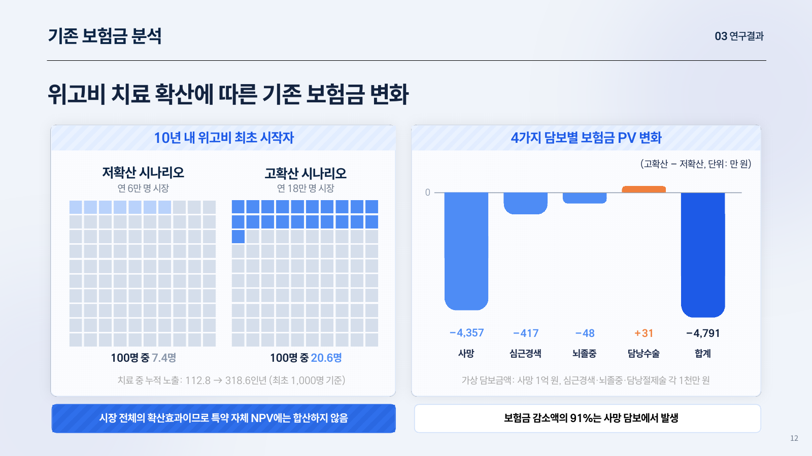

이 값은 임상효과의 적용 방식에 따라 달라집니다. 효과 없음 시나리오를 제외한 제시 시나리오에서는 감소액이 **1,137만~9,101만 원**으로 나타났습니다. 기준 결과를 확정 이익으로 해석하지 않고 가정에 따른 변동 범위도 함께 확인했습니다.

<details>
<summary>임상 가정 민감도 분석 보기</summary>

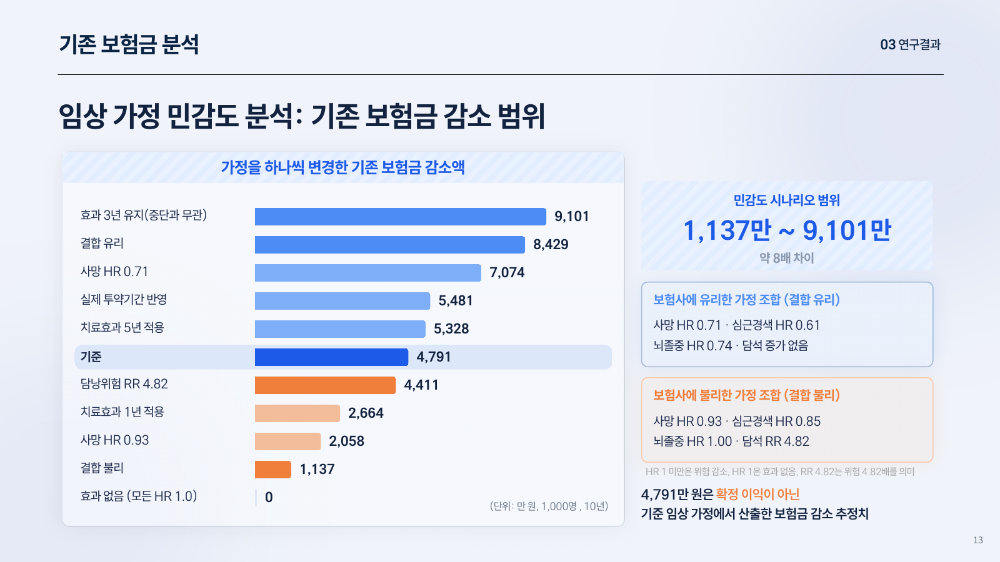

</details>

## 4. 27개 설계조합에서 8개 보장안으로

조제당 지원금 3수준, 지급횟수 3수준, 대기기간 3수준을 조합해 **27개 설계안**의 보험료와 스트레스 NPV를 비교했습니다. 이후 보장 효율과 손실 위험을 검토해 8개 비교 후보를 구성했습니다. 모든 후보가 모든 스트레스에서 수익을 보장하는 것은 아닙니다.

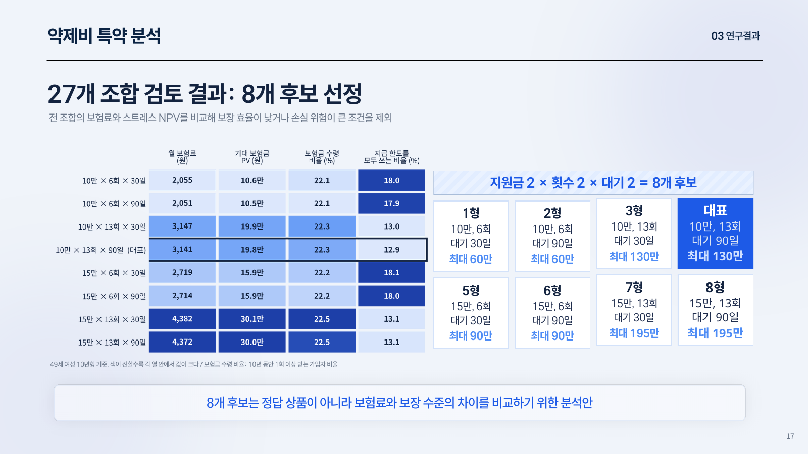

| 설계 조건 | 8개 후보의 범위 |
| --- | --- |
| 28일분 조제당 정액 지원 | 10만 원 / 15만 원 |
| 통산 최대 지급횟수 | 6회 / 13회 |
| 대기기간 | 30일 / 90일 |
| 가입연령·기간 | 19~69세 10년형 / 70~74세 5년형 |

대표 보장안은 **조제당 10만 원 · 최대 13회 · 대기 90일**입니다. 49세 여성·10년형·목표이익률 10% 기준 월보험료는 **3,141원**으로 산출했습니다.

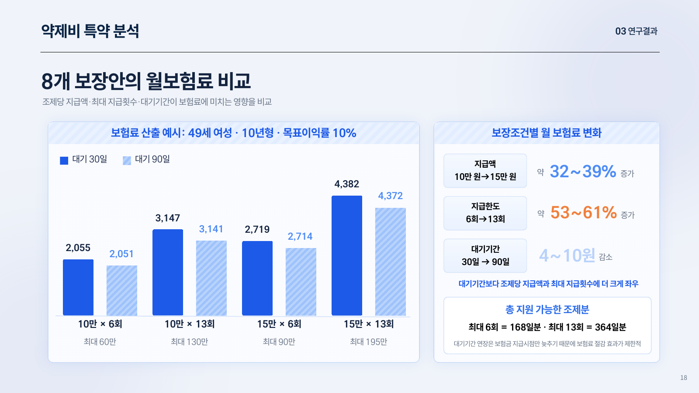

대기기간을 30일에서 90일로 늘렸을 때의 차이는 월 4~10원인 반면, 최대 지급횟수를 6회에서 13회로 늘리면 월보험료가 약 53~61% 증가했습니다. 이번 분석에서는 **지급액과 지급횟수가 가격 설계의 주요 변수**였습니다.

## 5. 보험료를 고정한 뒤, 예상보다 많이 이용하면?

기준 보험료를 유지한 채 치료 시작·지속·재개 가정을 바꾸었습니다. 대표 사례에서 연간 시작자 가정이 12만 명에서 18만 명으로 증가하면 이익률은 **10.0%에서 −20.3%**로 변했습니다. 시작규모와 지원반응을 동시에 높인 복합 스트레스에서는 **8개 후보 모두 음의 NPV**를 보였습니다.

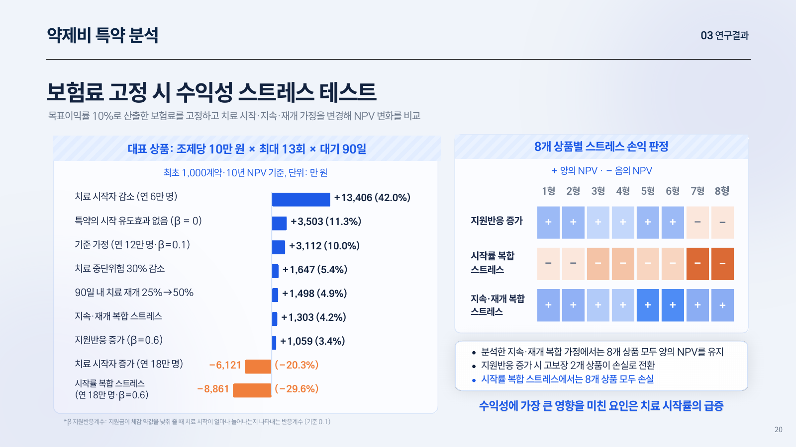

분석한 지속·재개 복합 시나리오에서는 8개 후보 모두 양의 NPV를 유지했습니다. 출시 후에는 치료 시작자 규모와 지원에 대한 반응을 관찰하고 가격 가정을 갱신해야 합니다.

## 6. 특약 도입의 최종 영향은?

시장 전체의 치료 확산으로 줄어드는 보험금을 특약 이익에 그대로 더하지 않았습니다. **동일한 시장에서 A와 A+B를 비교해, 특약 때문에 추가된 치료 B의 기존 보험금 변화만 반영**했습니다.

> 보험사 종합영향 = 약제비 특약 NPV + 특약으로 인한 기존 보험금 조정액

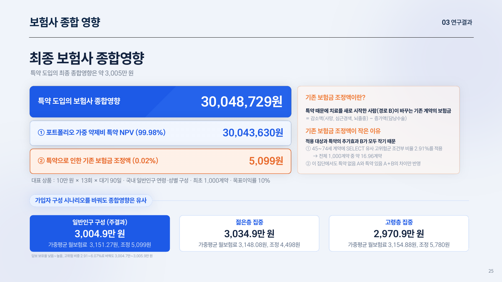

| 구성 요소 | 일반인구 구성 대리 · 최초 1,000계약 |
| --- | ---: |
| 약제비 특약 NPV | 30,043,630원 |
| 기존 보험금 조정액 | +5,099원 |
| **종합영향** | **30,048,729원** |

대표 상품·기준 가정에서 종합영향의 **99.98%는 특약 자체 NPV**였습니다. 기존 보험금 조정액은 고위험군에 한정하고 그 안에서도 추가 치료 효과만 반영해 작게 나타났습니다. 특약의 가격·지급조건·이용행태가 수익성 판단의 핵심이었습니다.

## 7. 계산 결과를 상품 문서로

산출 결과를 사업방법서, 보험료 산출방법서, 특별약관의 **3종 기초서류 형식**으로 구체화했습니다. 가입범위와 운영 규칙, 계산 근거, 지급 조건을 서로 연결해 확인할 수 있도록 구성했습니다.

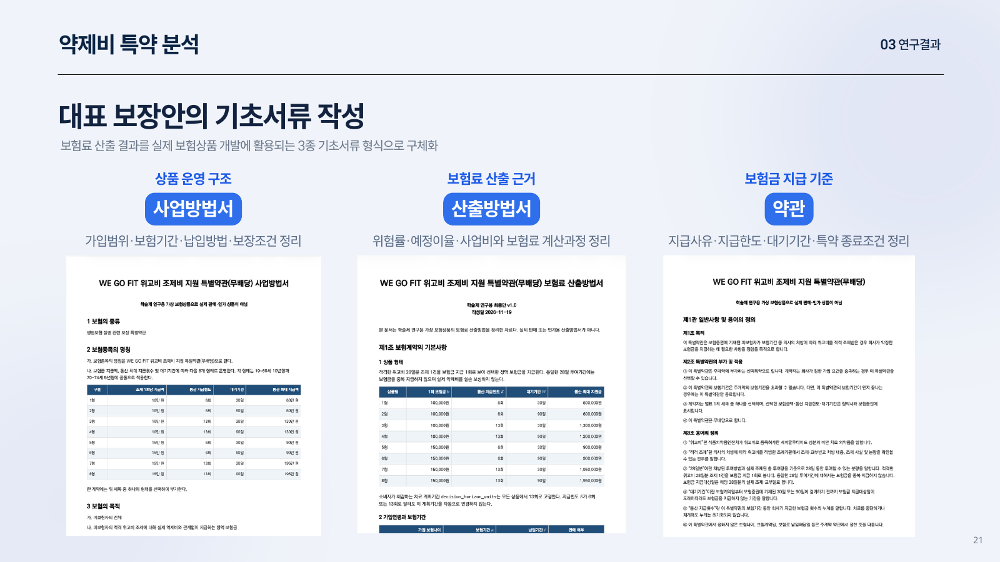

- [사업방법서](docs/product/WE_GO_FIT_사업방법서.pdf)
- [보험료 산출방법서](docs/product/WE_GO_FIT_보험료_산출방법서.pdf)
- [위고비 조제비 지원 특별약관](docs/product/WE_GO_FIT_위고비_조제비_지원_특별약관_무배당.pdf)

## 8. 분석을 직접 탐색하는 두 가지 MVP

### 고객용 · 나에게 맞는 보장을 살펴보기

연령·성별·키·몸무게를 입력하고 가입조건을 사전 확인한 뒤, 지원금·지급횟수·대기기간을 선택합니다. 선택에 따른 예상 월보험료와 치료비 부담 변화를 확인할 수 있습니다.

[고객용 시뮬레이터 열기](https://we-go-fit-customer.fun-pike-8674.chatgpt.site/)

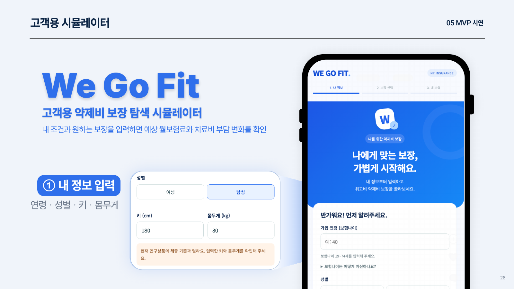

<details>
<summary>보험료와 혜택 결과 화면</summary>

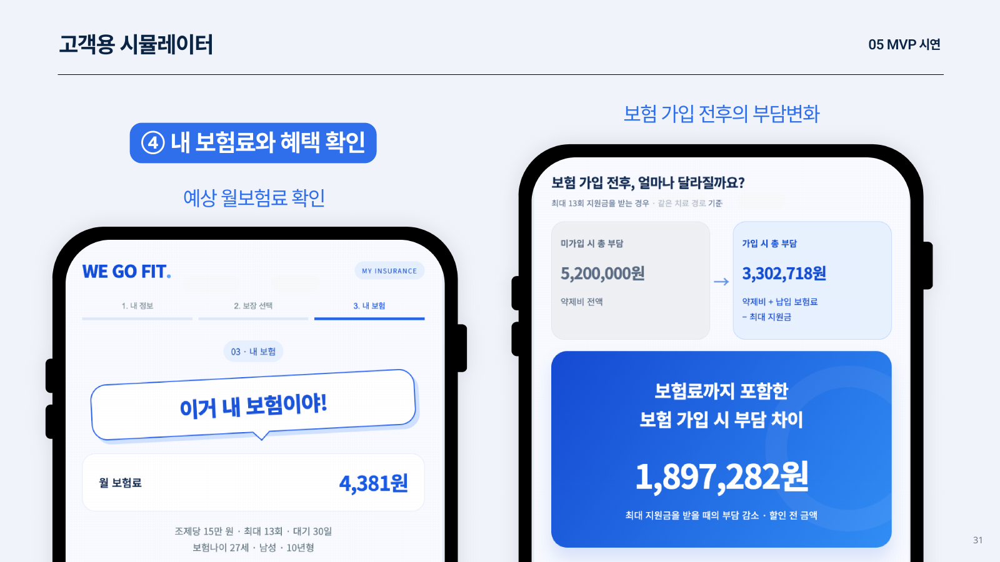

</details>

### 보험사용 · 조건을 바꾸며 손익을 비교하기

상품조건, 가입자 구성, 치료행태, 고위험군 비중과 담보 보유율을 조정하며 월보험료·특약 NPV·기존 보험금 조정액·종합영향을 비교합니다. 수입과 지출을 분해해 어떤 가정이 결과에 영향을 주는지도 살펴볼 수 있습니다.

[보험사용 시뮬레이터 열기](https://we-go-fit-insurer-drafts.fun-pike-8674.chatgpt.site/#one)

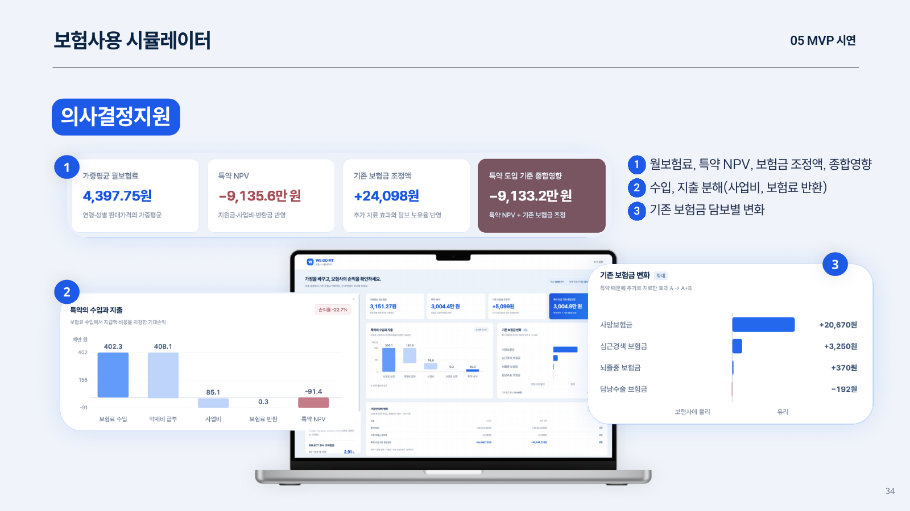

## 9. 한계와 다음 단계

국내 이용자의 장기 치료행태와 실제 보험사 보유계약 자료가 부족해 공개자료와 연구 가정을 사용했습니다. 해지율은 0%이며, 담보 보유율은 실제 포트폴리오 관측치가 아닌 대리 시나리오입니다. 임상효과도 국내 일반 가입자 전체에 일괄 적용하지 않았습니다.

향후에는 국내 처방·조제 자료, 경험해지율, 가입·역선택 행태, 담보별 보유율과 가입금액을 확보해 가정을 보정해야 합니다. 준비금·자본비용·세금·IFRS17을 포함한 실제 상품 수익성 검증도 별도로 필요합니다.

**WE GO FIT은 어떤 자료가 더 필요하고, 어떤 조건에서 수익성이 흔들리는지 미리 확인할 수 있는 분석 틀을 제안합니다.**

## 코드와 자료 둘러보기

| 경로 | 내용 |
| --- | --- |
| `models/start_rate`, `models/treatment` | 치료 시작과 지속·중단·재개 |
| `models/rider` | 계약 현금흐름·보험료·상품 비교 |
| `models/impact` | 기존 보험금·보험사 종합영향 |
| `config`, `data` | 입력 가정·참고자료·결과표 |
| `notebooks`, `reports`, `tests` | 분석 노트북·결과·자동 검증 |
| `docs/product` | 연구용 기초서류 |
| `docs/presentation`, `docs/images/slides` | 최종 발표 PDF와 슬라이드 캡처 |

[상세 분석·실행 안내](docs/analysis-guide.md)에서 전체 실행 순서와 검증 항목을 확인할 수 있습니다. README의 수치와 캡처는 최종 발표자료 기준이며, 입력 가정을 변경한 실행 결과와는 구분합니다.

```bash
python -m pip install -r requirements.txt
python -m unittest discover -s tests -v
```

## 함께 만든 사람들

**위험고비용** · 김민서 · 김사랑 · 문성환 · 임헌민 · 전해인 · 정다나

2026-2학기 DArt-B 제7회 학술제 보험 도메인
