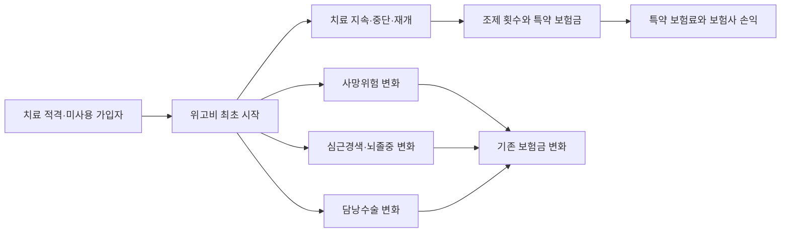

# WE GO FIT

> 위고비 치료 확산이 보험사에 미치는 영향을 분석하고, 위고비 조제비를 정액 지원하는 연구용 특약을 설계한 프로젝트입니다.

**WE GO FIT은 학술제 연구용 가상 보험상품입니다. 실제 판매·인가 상품이나 개인별 보험료 견적이 아닙니다.**

---

## 1. 프로젝트 한눈에 보기

위고비는 체중 감량뿐 아니라 심혈관질환과 사망위험에 영향을 줄 가능성이 있습니다. 반면 담석증 등 일부 부작용 위험을 높일 수도 있습니다.

보험사 입장에서는 다음 두 효과를 함께 살펴볼 필요가 있습니다.

| 분석 영역 | 주요 질문 |
|---|---|
| **신규 약제비 특약** | 위고비 조제비를 얼마까지 지원할 수 있으며 보험료는 얼마인가? |
| **기존 보험계약** | 위고비 확산으로 사망·심혈관·담낭수술 보험금은 어떻게 변하는가? |

본 프로젝트는 이를 다음과 같이 나누어 분석합니다.



---

## 2. 주요 결과물

### 위고비 조제비 지원 특약

- 조제당 **10만 원 또는 15만 원** 정액 지급
- 통산 **6회 또는 13회** 지급
- 가입 후 **30일 또는 90일** 대기
- 총 **8개 보장안** 비교
- 가입자의 연령·성별·선택 조건에 따른 월보험료 산출
- 치료 시작률과 지속·재개가 달라질 때의 보험사 손익 분석

### 기존 보험계약 영향

- 정기 사망보험금
- 비치명적 심근경색 급부
- 비치명적 뇌졸중 급부
- 담낭절제술 수술급부
- 네 담보를 같은 대상·기간·할인율로 통합한 종합 영향

---

## 3. 연구 대상과 상품 구조

### 가격산출 대상

현재 특약 보험료는 다음 가입자 집단을 기준으로 산출합니다.

- 성인
- 가입 전 위고비 치료 경험이 없음
- 분석 시작 시점에 위고비를 사용하지 않음
- 비당뇨
- 다음 중 하나의 치료 적격 기준 충족
  - BMI 30kg/㎡ 이상
  - BMI 27kg/㎡ 이상 30kg/㎡ 미만이면서 체중 관련 동반질환 보유

당뇨 가입자까지 보장하려면 치료 시작률과 치료 행태를 별도로 재산출해야 합니다.

### 가입연령과 보험기간

| 가입 보험나이 | 보험기간 | 보험료 납입기간 | 판매 후보 여부 |
|---:|---:|---:|---|
| 19~69세 | 10년 | 전기납 | 가능 |
| 70~74세 | 5년 | 전기납 | 가능 |
| 75세 이상 | 해당 없음 | 해당 없음 | 불가 |

판매계약의 최대 보장종료연령은 79세입니다. 70~74세는 5년형만 선택할 수 있습니다.

### 8개 보장안

| 상품형 | 조제당 지급액 | 최대 지급횟수 | 대기기간 | 통산 최대 지원금 |
|---|---:|---:|---:|---:|
| 1형 | 10만 원 | 6회 | 30일 | 60만 원 |
| 2형 | 10만 원 | 6회 | 90일 | 60만 원 |
| 3형 | 10만 원 | 13회 | 30일 | 130만 원 |
| 4형 | 10만 원 | 13회 | 90일 | 130만 원 |
| 5형 | 15만 원 | 6회 | 30일 | 90만 원 |
| 6형 | 15만 원 | 6회 | 90일 | 90만 원 |
| 7형 | 15만 원 | 13회 | 30일 | 195만 원 |
| 8형 | 15만 원 | 13회 | 90일 | 195만 원 |

보험금은 실제 약제비를 보상하는 실손급부가 아니라, 적격한 위고비 28일분 조제마다 지급하는 **정액급부**입니다.

---

## 4. 분석 방법

### 4.1 치료 시작률

치료 시작률은 다음 사람 중 일정 기간 안에 위고비를 처음 조제받는 비율입니다.

> 살아 있고 계약을 유지하며, 위고비 치료 적격이지만 아직 치료를 시작하지 않은 가입자

전국 신규 시작자 수가 직접 공개되지 않아 다음 세 가지 시장 규모를 조건부 시나리오로 사용했습니다.

| 시나리오 | 연간 신규 시작자 가정 | 의미 |
|---|---:|---|
| 낮은 이용 | 6만 명 | 이용이 적은 경우 |
| 기준 | 12만 명 | 보험료 산출 기준 |
| 높은 이용 | 18만 명 | 이용이 많은 경우 |

특약의 지원 수준이 높아지면 치료 시작을 결정하는 사람이 증가할 수 있습니다. 따라서 지급액·지급한도·대기기간이 바뀔 때마다 치료 시작률을 다시 계산합니다.

기준상품인 `10만 원×13회×90일`에서 첫해 시작률은 다음과 같습니다.

- 특약 없음: 약 **2.456%**
- 특약 있음: 약 **2.504%**
- 특약으로 인한 추가 시작: 약 **0.049%p**

### 4.2 치료 지속·중단·재개

치료를 시작한 사람이 계속 위고비를 사용하는지 일별로 추적합니다.

| 치료 시작 후 시점 | 지속률 |
|---:|---:|
| 3개월 | 87% |
| 6개월 | 73% |
| 9개월 | 61% |
| 12개월 | 51% |

기본 모형은 다음 규칙을 사용합니다.

- 위고비 1회 조제는 28일분
- 마지막 약제 소진 후 60일 이상 공백이면 중단
- 중단 후 90일 동안 재개 가능
- 재개 관찰창 내 누적 재개율 25%
- 재개하면 치료 경과시계는 다시 시작
- 기존 보험금 지급횟수는 초기화하지 않음

### 4.3 계약 현금흐름

매일 다음 순서로 계약 상태와 현금흐름을 계산합니다.

```text
보험료 수납
→ 최초 치료 시작
→ 치료 중단·재개
→ 위고비 조제와 보험금 지급
→ 지급한도 소진과 미경과보험료 반환
→ 사망
→ 다음 날 상태로 이동
```

특약이 통산 지급한도를 모두 소진하면 종료됩니다. 이미 납입한 당월 보험료 중 소진일 이후 기간에 해당하는 금액은 일할 계산하여 반환합니다.

### 4.4 보험료 산출

보험료에는 다음 항목을 반영합니다.

- 예상 위고비 조제보험금
- 계약 체결비
- 월 유지비
- 수금비
- 보험금 청구 심사비
- 지급한도 소진 시 미경과보험료 반환
- 사망에 따른 계약 종료
- 예정이율 연 2.75%

판매 후보 보험료는 기준 가정에서 **목표이익률 10%**가 되도록 산출합니다.

여기서 목표이익률은 다음 연구용 지표입니다.

> 보험료 수입의 현재가치에서 보험금·사업비·반환금의 현재가치를 뺀 금액 ÷ 보험료 수입의 현재가치

이는 실제 회계이익이나 IFRS17 보험계약마진을 의미하지 않습니다.

### 4.5 수지 검증

보험료를 산출한 후에는 보험료를 다시 바꾸지 않고 다음 경험 가정만 변경합니다.

- 실제 치료 시작자가 예상보다 많거나 적은 경우
- 지원금에 대한 치료 시작 반응이 예상보다 큰 경우
- 치료 중단이 줄어드는 경우
- 치료 재개가 많아지는 경우
- 재개 후 치료가 더 오래 지속되는 경우

이때 계산되는 손익은 다음과 같습니다.

```text
손익 현재가치
= 보험료 수입 현재가치
- 보험금 현재가치
- 사업비 현재가치
- 미경과보험료 반환 현재가치
```

스트레스 시나리오에는 발생확률을 부여하지 않았습니다. 따라서 적자 시나리오가 존재한다고 해서 실제 적자 확률이나 파산 확률을 의미하지는 않습니다.

---

## 5. 특약 분석 주요 결과

### 49세 여성·10년형 기준

판매 목표이익률 10%를 반영한 원 단위 올림 월보험료입니다.

| 지급액×한도 | 대기기간 | 월보험료 | 최대 지원금 |
|---|---:|---:|---:|
| 10만 원×6회 | 30일 | 2,055원 | 60만 원 |
| 10만 원×6회 | 90일 | 2,051원 | 60만 원 |
| 10만 원×13회 | 30일 | 3,147원 | 130만 원 |
| 10만 원×13회 | 90일 | 3,141원 | 130만 원 |
| 15만 원×6회 | 30일 | 2,719원 | 90만 원 |
| 15만 원×6회 | 90일 | 2,714원 | 90만 원 |
| 15만 원×13회 | 30일 | 4,382원 | 195만 원 |
| 15만 원×13회 | 90일 | 4,372원 | 195만 원 |

이 보험료는 49세 여성 기준 예시입니다. 실제 연구용 조회표에서는 연령·성별·상품조건별로 보험료를 다시 산출합니다.

### 대표상품

대표 회귀검증 상품은 `10만 원×13회×90일`입니다.

| 지표 | 기준 결과 |
|---|---:|
| 목표이익률 10% 월보험료 | 3,141원 |
| 10년 내 최초 시작자 비율 | 약 22.32% |
| 1회 이상 보험금 수급자 비율 | 약 22.28% |
| 13회 한도 소진 비율 | 약 12.95% |
| 계약 1건당 기대 보험금 현재가치 | 약 19.82만 원 |

### 연령별 결과

- 19~69세 10년형 대표상품 보험료는 연령과 성별에 따라 약 3,140~3,148원
- 70~74세 5년형 대표상품 보험료는 약 3,290~3,297원
- 70~74세의 8개 상품 전체 보험료 범위는 약 2,212~4,558원

5년형은 납입기간이 짧기 때문에 동일한 보장안의 10년형보다 월보험료가 높을 수 있습니다.

### 스트레스 결과

- 치료 시작자가 크게 증가하는 복합 스트레스에서는 8개 상품 모두 손실
- 치료 지속·재개 복합 스트레스에서는 목표이익률 10% 기준 8개 상품 모두 양의 손익
- `15만 원×13회`는 지원반응이 높은 경우 목표이익률 10% 보험료에서도 손실 가능

따라서 8개 보장안은 유일한 최적 상품이 아니라, 보험료·보장수준·위험을 함께 비교하기 위한 MVP 후보군입니다.

---

## 6. 기존 보험계약 영향 분석

위고비의 건강효과는 특약 보험료에서 직접 차감하지 않고 기존 보험계약 영향으로 별도 분석합니다.

분석 대상은 SELECT 임상시험과 유사한 비당뇨·심혈관 고위험 가상 가입자 1,000명입니다.

### 분석한 가상 담보

| 담보 | 지급조건 | 가상 보험금 |
|---|---|---:|
| 정기 사망보장 | 보험기간 중 사망 | 1억 원 |
| 심근경색 급부 | 최초 비치명적 심근경색 | 1,000만 원 |
| 뇌졸중 급부 | 최초 비치명적 뇌졸중 | 1,000만 원 |
| 담낭수술 급부 | 담석증이 담낭절제술로 이어진 경우 | 1,000만 원 |

### 기준 결과

저확산과 고확산을 비교한 보험금 현재가치 변화입니다.

| 담보 | 고확산−저확산 |
|---|---:|
| 정기 사망보험금 | -43,571,696원 |
| 비치명적 심근경색 급부 | -4,169,987원 |
| 비치명적 뇌졸중 급부 | -477,162원 |
| 담낭절제술 급부 | +309,106원 |
| **기존 보험금 합계 변화** | **-47,909,740원** |

위고비 고확산 시 기존 보험금은 1,000명 기준 약 **4,791만 원 감소**했습니다. 부호를 보험사 관점으로 전환하면 보험사에 약 **4,791만 원의 유리한 영향**, 계약 1건당 약 **47,910원**입니다.

가장 큰 영향은 사망보험금 감소에서 발생했습니다. 담낭수술 급부 증가는 사망·심혈관 급부 감소액의 약 0.64%를 상쇄했습니다.

이 결과는 위고비의 **시장 전체 확산 효과**입니다. 특약 때문에 추가로 치료를 시작한 사람의 효과로 바로 해석할 수 없습니다.

---

## 7. 특약 손익과 기존 보험금 변화의 관계

보험사의 전체 영향은 개념적으로 다음과 같습니다.

```text
보험사 종합 영향
= 약제비 특약 손익
+ 특약으로 인해 달라진 기존 보험금
```

다만 현재 기존 보험금 종합분석은 저확산과 고확산이라는 시장 시나리오를 비교합니다. 이를 특약 손익과 결합하려면 다음 보완이 필요합니다.

1. 특약이 없어도 치료할 사람과 특약 때문에 추가로 치료한 사람을 구분
2. 추가 치료 시작자에게만 기존 보험금 변화를 귀속
3. 해당 가입자가 실제로 보유한 사망·심혈관·수술 담보 비중 적용
4. 기존 계약의 보험금·잔여기간·해지율 적용

따라서 현재 저장소에서는 특약 손익과 시장 확산에 따른 기존 보험금 변화를 분리해 제시합니다.

---

## 8. 주요 자료와 출처

| 분석 항목 | 주요 자료 | 적용 내용 |
|---|---|---|
| 치료 적격 인구 | 국민건강영양조사 2024 팀 집계 | 비당뇨 치료 적격인구 추정 |
| 위고비 허가 기준 | [식품의약품안전처 의약품통합정보시스템](https://nedrug.mfds.go.kr/pbp/CCBBB01/getItemDetailCache?cacheSeq=202301388a) | 성인 BMI 및 동반질환 기준 |
| 치료 지속·중단 | [Mailhac et al., JAMA Network Open 2026](https://jamanetwork.com/journals/jamanetworkopen/fullarticle/2853380) | 3·6·9·12개월 지속률, 60일 공백, 재개 근사 |
| 장기 지속률 | [Rodriguez et al., JAMA Network Open](https://jamanetwork.com/journals/jamanetworkopen/fullarticle/2829779) | 비당뇨 GLP-1 사용자의 12·24개월 지속률 |
| 기초 사망률 | [보험개발원 공개 참조순보험요율 예시](https://www.kidi.or.kr/user/nd81768.do) | 성별·연령별 사망확률 및 보간 |
| 사망·심혈관 효과 | [SELECT 본 논문](https://doi.org/10.1056/NEJMoa2307563) | 사망·심근경색·뇌졸중 위험비 |
| 국내 담낭절제술 전환 | [Scientific Reports 2023](https://doi.org/10.1038/s41598-023-33440-4) | 담석증 환자의 담낭절제술 전환율 |
| 담낭 위험 민감도 | [Safwan et al. 2025](https://doi.org/10.5144/0256-4947.2025.129) | 담낭질환 위험의 불리 시나리오 |

치료 시작자 6만·12만·18만 명, 가입 선택비, 지원반응계수, 사업비 등은 관측값이 아니라 연구팀의 조건부 가정입니다.

자료별 상세 출처와 한계는 [자료와 코드 출처](docs/provenance.md) 및 [치료 근거표](data/reference/treatment_sources.csv)에서 확인할 수 있습니다.

---

## 9. 용어 설명

| 용어 | 의미 |
|---|---|
| 치료 시작률 | 아직 치료하지 않은 적격 가입자가 위고비를 처음 조제받을 확률 |
| 지속률 | 치료를 시작한 사람이 일정 시점까지 치료를 계속하는 비율 |
| 재개율 | 치료를 중단한 사람이 정해진 기간 안에 다시 시작하는 비율 |
| 급부 | 보험사가 지급하는 보험금 |
| 현재가치·PV | 미래 금액을 예정이율로 할인하여 현재 시점의 가치로 환산한 금액 |
| NPV·손익 현재가치 | 보험료 수입 현재가치에서 보험금·사업비·반환금 현재가치를 뺀 금액 |
| 목표이익률 | 기준 가정에서 보험료 수입 대비 일정 손익을 확보하도록 정한 연구용 가격 기준 |
| HR | 치료군의 사건위험을 비교군과 비교한 값. 예를 들어 HR 0.81은 상대위험이 약 19% 낮다는 뜻 |
| 스트레스 시나리오 | 실제 발생확률이 아니라 가정이 불리하게 변했을 때 손익을 확인하는 조건 |
| MVP | 실제 출시 확정안이 아니라 비교·시연을 위해 추린 초기 상품 후보군 |

---

## 10. 주요 시각화와 노트북

GitHub에서 노트북을 열면 실행 결과와 그래프를 함께 확인할 수 있습니다.

| 노트북 | 주요 시각화 |
|---|---|
| [상품조건 비교](notebooks/위고비_상품조건_비교.ipynb) | 8개 상품 보험료와 스트레스 손익 비교 |
| [가입연령 검토](notebooks/위고비_MVP_가입연령_검토.ipynb) | 연령·성별 보험료, 기대보험금, 5년형 비교 |
| [사망보장 분석](notebooks/impact/01_위고비_사망보장_국내연구.ipynb) | 연도별 사망보험금 감소와 민감도 |
| [심혈관 급부 분석](notebooks/impact/02_위고비_심혈관보험금_국내연구.ipynb) | 심근경색·뇌졸중 급부 변화 |
| [담낭수술 급부 분석](notebooks/impact/03_위고비_담낭수술보험금_국내연구.ipynb) | 담낭절제술 증가와 민감도 |
| [기존 보험금 종합영향](notebooks/impact/04_위고비_기존보험금_종합영향.ipynb) | 담보별 워터폴, 저·고확산 비교, 결합 시나리오 |
| [계약 현금흐름](notebooks/04_계약현금흐름.ipynb) | 일별 계약 상태와 보험료·보험금 흐름 |

---

## 11. 저장소 구조

```text
glp1_pricing_analysis/
├── config/                  # 상품·시작률·치료·스트레스 설정
├── data/
│   ├── reference/           # 사망률·치료 근거·대상 인구
│   └── derived/             # 판매보험료와 분석 결과표
├── docs/
│   ├── product/             # 사업방법서·산출방법서
│   └── ...                  # 분석별 계산 규칙과 한계
├── models/
│   ├── start_rate/          # 최초 치료 시작률
│   ├── treatment/           # 지속·중단·재개
│   ├── rider/               # 특약 현금흐름·보험료·수지
│   └── impact/              # 기존 보험금 종합영향
├── notebooks/               # 표와 시각화
├── reports/                 # 기준 결과와 검증 보고서
├── tests/                   # 자동 검증
└── outputs/                 # 실행 시 생성되는 상세 결과, Git 제외
```

### 주요 상품 문서

- [사업방법서 Markdown](docs/product/WE_GO_FIT_사업방법서.md)
- [사업방법서 DOCX](docs/product/WE_GO_FIT_사업방법서.docx)
- [사업방법서 PDF](docs/product/WE_GO_FIT_사업방법서.pdf)
- [보험료 산출방법서](docs/product/WE_GO_FIT_산출방법서.md)

### 주요 결과 데이터

- [MVP 8개 상품 요약](data/derived/mvp_product_options_summary.csv)
- [전 연령·성별·상품별 판매보험료 896행](data/derived/sale_product_age_lookup.csv)
- [대표연령·고령 확장 요약](data/derived/sale_product_age_representative_summary.csv)
- [70~74세 5년형 상세 결과](data/derived/senior_extension_5year_results.csv)

---

## 12. 실행 방법

Python 3.10 이상 환경에서 저장소 루트 기준으로 실행합니다.

```bash
python -m pip install -r requirements.txt
```

### 전체 분석 실행

```bash
python -m models.start_rate.run
python -m models.rider.start_integration
python -m models.rider.cashflows
python -m models.rider.pricing
python -m models.rider.validate_pricing
python -m models.rider.profit_analysis
python -m models.rider.treatment_sensitivity
python -m models.rider.product_comparison --stage full
python -m models.rider.mvp_age_analysis --build-sale-lookup
python -m models.impact.existing_claims
```

`models.rider.pricing`의 기본 목표이익률 0%는 기존 결과를 확인하기 위한 회귀검증용입니다. 판매 후보 보험료는 `mvp_age_analysis`에서 목표이익률 10%로 생성합니다.

### 자동 검증

```bash
python -m unittest discover -s tests -v
```

현재 최종 기준으로 **79개 테스트를 통과**했습니다.

검증 항목에는 다음이 포함됩니다.

- 일별 인원 보존
- 확률 범위
- 지급한도 초과 방지
- 만기 이후 무납입·무지급
- 미경과보험료 반환
- 보험료 산식 재현
- 고정 보험료 스트레스 손익
- 가입연령과 보험기간 검증
- 896개 판매 조회 조합의 중복·결측 검증

---

## 13. 해석할 때 주의할 점

- 이 결과는 실제 보험사의 보유계약 자료를 사용한 것이 아닙니다.
- 치료 시작자 수와 보험료 반응은 조건부 시나리오입니다.
- 실제 연령별 치료 시작률·재개율·해지율은 확보되지 않았습니다.
- 가격 모형은 비당뇨 집단을 기준으로 합니다.
- 가입자의 보험료 수준에 따른 가입 포기나 추가 역선택은 반영하지 않았습니다.
- 시작률 스트레스와 치료행태 스트레스는 각각 분석했으며 전체 교차 충격은 계산하지 않았습니다.
- 세금·자본비용·준비금·투자손익·IFRS17 보험계약마진은 포함하지 않았습니다.
- SELECT는 해외 고위험 임상시험이므로 국내 일반 보험가입자에게 그대로 적용할 수 없습니다.
- 기존 보험금 종합영향은 시장 확산 효과이며 특약의 순효과와 동일하지 않습니다.
- 연구용 적립액 산식은 향후 연구 범위이며 현재 코드에 구현되어 있지 않습니다.

---

## 14. 결론

WE GO FIT은 위고비를 단순한 약제비 보장 대상으로만 보지 않습니다.

- 소비자에게는 치료비 부담을 낮추는 정액 특약을 제안하고,
- 보험사에는 치료 시작·지속·재개에 따른 특약 손익을 보여주며,
- 기존 사망·심혈관·수술 담보의 보험금 변화까지 함께 검토할 수 있는 분석 구조를 제공합니다.

분석 결과, 보장 수준을 높이면 소비자 혜택은 커지지만 치료 시작자의 증가와 장기 지급위험도 함께 커졌습니다. 또한 위고비 확산은 사망·심혈관 보험금을 감소시킬 가능성이 있지만 담낭수술 급부를 일부 증가시킬 수 있었습니다.

따라서 위고비 관련 보험상품은 약제비 특약의 단독 수익성뿐 아니라 **치료행태 변화와 기존 보험 포트폴리오의 영향을 함께 고려하여 설계해야 합니다.**